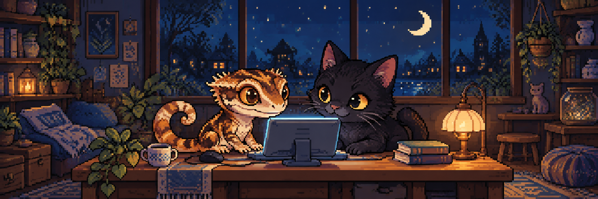
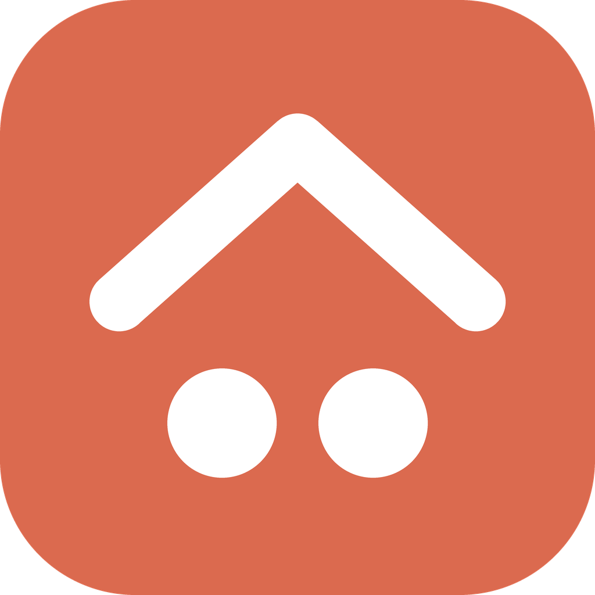
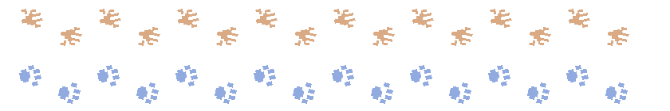

# KH Side

**둘이서 꼼지락꼼지락, 작은 아이디어를 만들어요.**

게코와 고양이의 작은 작업실

 

## 🫧 우리 작업실

> “이런 거 있으면 좋겠다”에서 시작하는 작은 프로젝트들.

게코 한 마리와 고양이 한 마리가 모여, 
우리 일상에 있었으면 하는 것들을 만들어요.

좋아하는 것을 담고, 직접 써보고, 
둘이서 조금씩 다듬어가는 중이에요.

 

## 🌱 요즘 만드는 것

### [오늘 출국](https://tripport.notion.site/494f62abeadb821db099810d938d1be9?v=95cf62abeadb832dab250894803ba23e&source=copy_link)

**어디로 떠날지 모르는 설렘, 도장으로 남기는 나만의 여행.**

국내 랜덤 여행을 떠나 미션을 수행하고, 
출국·입국 스탬프를 모아 여행의 추억을 기록하는 앱이에요.

뜻밖의 목적지에서 새로운 하루를 만나고, 
하나씩 쌓이는 도장 속에 나만의 여행 이야기를 담아요.

`2026년 11월 중순 출시 예정`

 

### 한지붕

**같이 사는 우리, 살림도 함께 가볍게.**

집안일을 나누고, 냉장고 속 재료와 유통기한을 챙기고, 
즐겨 먹는 레시피에 필요한 재료와 부족한 재료도 확인해요. 
청소 현황부터 청소도구와 생필품까지, 우리 집 살림을 한곳에서.

친구와 살아도, 연인과 살아도. 
우리 사이에 맞는 분위기로 함께 쓰는 공동생활 앱을 준비하고 있어요.

`다음 프로젝트 · 준비 중`

 

## 🐾 작업실의 일상

- 작은 아이디어 하나 꺼내놓기
- 나란히 앉아 꼼지락꼼지락 만들기
- 직접 써보고, 같이 고쳐보기

 

오늘도 둘이서, 조금씩.

  

